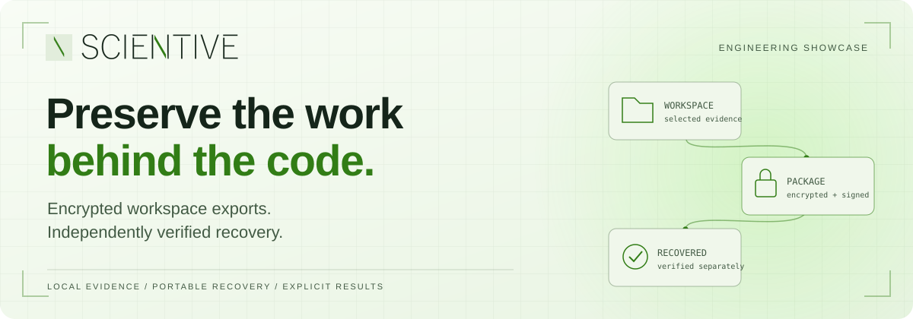
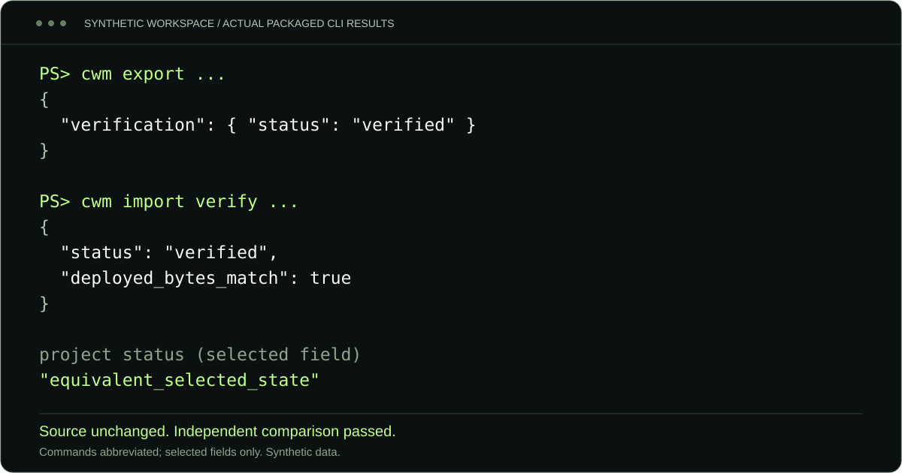
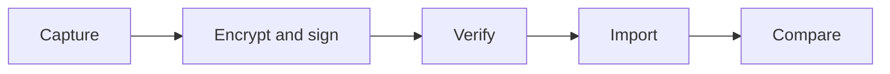

<picture>
  <source media="(prefers-color-scheme: dark)" srcset="docs/assets/readme/hero-dark.svg">
  <source media="(prefers-color-scheme: light)" srcset="docs/assets/readme/hero-light.svg">
  
</picture>

# Codex Workspace Recovery

A **Scientive Line engineering showcase** for preserving the knowledge held in local Codex conversations, attachments and selected project state.

[](https://github.com/scientiveline-lda/CodexWorkspaceRecovery/actions/workflows/windows.yml)
[](https://github.com/scientiveline-lda/CodexWorkspaceRecovery/actions/workflows/codeql.yml)
[](docs/compatibility.md)
[](LICENSE)

**[See the workflow](#see-the-recovery-workflow)** · **[Engineering decisions](#what-the-engineering-demonstrates)** · **[Validation](#evidence-over-assurances)** · **[Operator guide](docs/operator-runbook.md)**

Import reconstructs a **separate filesystem workspace**. Native Codex sidebar restoration, account transfer and cloud-history migration are outside this project's scope.

## The work is more than the repository

A repository records the code. The surrounding conversations often explain the architecture, rejected alternatives, investigations and decisions that made it possible. Attachments and unfinished working changes supply another part of the picture. Losing those connections makes an engineering project harder to understand and continue.

Codex Workspace Recovery addresses that continuity problem with a practical sequence: capture supported local evidence, protect it in a portable package, reconstruct it elsewhere, and compare the result against authenticated expectations. Missing information remains visible in the report instead of disappearing behind a successful file copy.

For Scientive Line, this project demonstrates how we approach consequential software: explicit boundaries, inspectable evidence and recovery paths designed alongside the successful path.

## See the recovery workflow

The demonstration below comes from an **executed Windows distribution**, outside the developer checkout, using disposable synthetic conversations, an attachment and a dirty Git project. It includes encryption, independent package verification, import and an independently calculated source-to-destination comparison.

<picture>
  <source media="(max-width: 600px)" srcset="docs/assets/readme/terminal-mobile.svg">
  
</picture>

*Commands and JSON are abbreviated. These are selected results from a synthetic run, not a native Codex interface or a production-account migration.*

<details>
<summary>Read the selected results as text</summary>

```text
cwm export ...
  verification.status: "verified"

cwm import verify ...
  status: "verified"
  deployed_bytes_match: true
  projects[0].status: "equivalent_selected_state"
```

A separate fixture oracle also passed its content comparison, and the source byte inventory remained unchanged. The [operator guide](docs/operator-runbook.md) contains complete command syntax and prerequisites.

</details>



Source writers are closed before capture. The archive is authenticated before extraction and semantically checked before deployment. Import publishes into a new destination only after verification; the final comparison checks the recovered evidence and selected project state.

## What the engineering demonstrates

| Engineering choice | Practical consequence |
| --- | --- |
| **Preserve evidence before deriving views** | Original transcript bytes and unknown events remain available alongside readable history, so interpretation does not replace the original record. |
| **Check recovery independently** | A separate cryptographic verifier checks package membership, signatures and hashes; semantic checks reconcile histories and references, while acceptance tests use an independent fixture oracle. |
| **Make deployment non-destructive** | Plans expose mappings and expected writes. Existing targets are refused; reapplication, resume and rollback protect unrelated content and subsequent work. |
| **Package the recovery environment** | The Windows build includes Python, age, Minisign and MinGit. Normal export/import needs no developer checkout, installed Git or recovery-time downloads. |

These decisions are explained in the [architecture](docs/architecture.md), [format specification](docs/CWMF.md) and [security model](docs/security.md).

## Evidence over assurances

The **v0.3.0 reference validation** recorded the following results. These are scoped engineering measurements, not a certification or a guarantee for every installation.

| Reference check | Recorded outcome |
| --- | --- |
| Required automated tests | **110 passed**, zero skips or failures |
| Real process-termination boundaries | **9 passed** |
| Deliberate safety mutations | **4 detected** |
| Packaged reference recovery | **685 sessions**, independently compared |
| Unsigned distribution builds | **2 byte-identical builds** |

See the [public validation summary](docs/validation-summary.md) for provenance, workloads, refusal cases and limitations. Live badges above report GitHub's current workflow status separately from these historical results.

## Evaluate the project

Start with the [installation and developer setup](docs/installation.md), then use the [CLI reference](docs/cli-reference.md) and [operator guide](docs/operator-runbook.md). **No public binary release is currently offered.** The self-contained Windows distribution has been built and tested; source evaluation and building require the documented development environment and separately authorized use under [LICENSE](LICENSE).

| Boundary | Current scope |
| --- | --- |
| **Supported** | Windows 11 x64, local NTFS; supported active/archived history, available attachments, selected records, project bytes, empty directories and tested Git state. |
| **Limited** | Closed-writer capture verifies observed bytes and membership, not an atomic application-wide snapshot. Missing content and excluded metadata are reported. |
| **Refused or unsupported** | Existing-target merging, native/account/cloud restoration, WSL/remote capture, unsafe paths and uncertified Git states. See the [compatibility matrix](docs/compatibility.md). |

Export archives are encrypted and locally signed. Distribution ZIPs remain **unsigned**; a checksum alone does not authenticate their publisher. Keep recovery keys separately, protect plaintext staging and retain independent backups. Further operational guidance is in [troubleshooting](docs/troubleshooting.md) and [security](docs/security.md).

## Built by Scientive Line

We combine engineering experience with software development to turn complex operational problems into dependable digital tools. This showcase makes that approach inspectable: the implementation, trade-offs, tests and limits are all part of the work.

**[Explore our portfolio](https://scientiveline.com/portfolio)** · **[Discuss a software engineering challenge](https://scientiveline.com/contact)** · **[Scientive Line](https://scientiveline.com/)**

---

This is a showcase, provided without warranty or support commitment. Users remain responsible for their use and backups; liability is excluded to the extent permitted by law. **All rights reserved.** See [LICENSE](LICENSE). This independent project is not affiliated with or endorsed by OpenAI.
