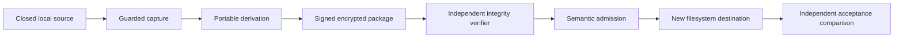

# Architecture

Capture, portable derivation, cryptographic verification, semantic admission and deployment remain separate. SQLite recovery and Git derivation operate only on staging copies. The standalone verifier intentionally duplicates small trust/path rules and does not import application adapters.

Unknown historical events retain exact raw bytes and structured representations. Database readers export only declared ownership/columns and report unreviewed structures. Imported configuration is inert evidence. No native Codex projection or account integration is present.

Import plans bind archive, trust, toolchain, mappings and expected writes. Kernel locks coordinate deployment/recovery. Restricted plan-workspace baselines cannot be redefined by editing destination markers. Same-user malicious tampering and filesystem races are not a full OS isolation boundary.
